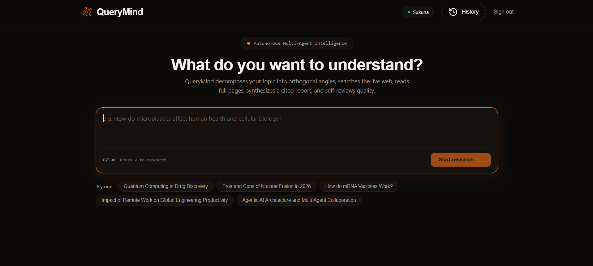
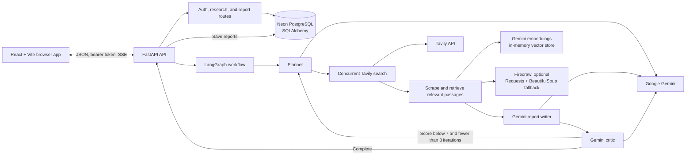

# QueryMind

**Turn a research question into a cited report.** QueryMind is a web research assistant that searches the live web, reads relevant pages, drafts a structured report, and asks a critic agent to review its quality. Reports can be saved to a per-user library.

[Live app](https://querymind-research.vercel.app/) | [Backend API docs](https://querymind-giya.onrender.com/docs) | [GitHub](https://github.com/AyushPawshe08/QueryMind)


## What it does

- Validates topics before starting research.
- Breaks each topic into focused search queries and searches them concurrently with Tavily.
- Scrapes up to five source pages, then retrieves relevant passages with Gemini embeddings and an in-memory vector store. Firecrawl is optional; Requests and BeautifulSoup are the fallback.
- Writes a Markdown report with source links and optional chart data, then scores and critiques it. Low-scoring reports can go through another research cycle, up to three iterations.
- Streams progress to the browser with Server-Sent Events (SSE).
- Supports registration, sign-in, and saved report history backed by Neon PostgreSQL.



## Architecture and AI workflow



The graph state carries the topic, sub-queries, search results, extracted passages, sources, report, critique, score, iteration count, and chart data. The vector store is created for each research run and is not persistent.

## Tech stack

| Area | Technology | Role |
| --- | --- | --- |
| Frontend | React 19, Vite 8 | Landing page, auth forms, research workspace, report history |
| API | FastAPI, Pydantic | Authentication, validation, research, and report endpoints |
| Agent workflow | LangGraph, LangChain | Planner -> search -> read/retrieve -> writer -> critic loop |
| Language model | Google Gemini (`gemini-3.5-flash-lite`) | Topic validation, agent reasoning, writing, and critique |
| Search and scraping | Tavily, optional Firecrawl, Requests, BeautifulSoup | Web discovery and page extraction |
| Persistence | Neon PostgreSQL, SQLAlchemy | User accounts and saved reports |
| Authentication | PyJWT, pwdlib Argon2 | Signed bearer tokens and password hashing |

## Run locally

### Requirements

- Python 3.12 or newer
- Node.js 20.19+ or 22.12+
- npm
- Google Gemini and Tavily API keys
- A PostgreSQL database (the hosted app uses Neon)

### 1. Configure and start the backend

From the repository root, in PowerShell:

```powershell
Copy-Item backend\.env.example backend\.env
```

Fill in the values in `backend/.env` (see [Environment variables](#environment-variables)), then install and start the API:

```powershell
py -3.12 -m venv backend\.venv
.\backend\.venv\Scripts\python.exe -m pip install -r backend\requirements.txt
Set-Location backend
.\.venv\Scripts\python.exe -m uvicorn main:app --reload --port 8000
```

The API initializes its tables during startup. Keep this terminal open while using the app. API docs are at [http://127.0.0.1:8000/docs](http://127.0.0.1:8000/docs).

### 2. Configure and start the frontend

In a second terminal from the repository root:

```powershell
Copy-Item frontend\.env.example frontend\.env.local
Set-Location frontend
npm install
npm run dev
```

Open the local URL printed by Vite (usually [http://localhost:5173](http://localhost:5173)). The local frontend API URL is set in `frontend/.env.local`.

## Environment variables

Backend values go in `backend/.env`; the safe template is [`backend/.env.example`](backend/.env.example). Frontend values go in `frontend/.env.local`; use [`frontend/.env.example`](frontend/.env.example). Never commit real credentials.

| Variable | Required | Used by | Description |
| --- | --- | --- | --- |
| `GOOGLE_API_KEY` | Yes | Backend | Gemini model and embedding access |
| `TAVILY_API_KEY` | Yes | Backend | Live web search |
| `DATABASE_URL` | Yes | Backend | PostgreSQL URL; use the Neon URL with `sslmode=require` |
| `JWT_SECRET_KEY` | Yes in production | Backend | Private signing key for auth tokens; set a long random value |
| `FIRECRAWL_API_KEY` | No | Backend | Enables Firecrawl scraping; Requests and BeautifulSoup are used as fallback |
| `VITE_API_BASE_URL` | No locally; set in Vercel | Frontend | Backend origin, e.g. `https://querymind-giya.onrender.com` |

Generate a JWT key with `python -c "import secrets; print(secrets.token_urlsafe(48))"`. Set secrets in the hosting provider's environment settings, not in frontend variables.

## Use the app and API

1. Create an account or sign in.
2. Enter a factual research topic and start a run.
3. Follow planner, search, read, write, and critic progress in the workspace.
4. Review the report, sources, score, and any chart data. Open History to revisit saved reports.

The API is documented interactively at `/docs`.

| Method | Endpoint | Purpose |
| --- | --- | --- |
| `GET` | `/health` | Health check |
| `POST` | `/auth/register` | Create an account |
| `POST` | `/auth/login` | Sign in and receive a bearer token |
| `GET` | `/auth/me` | Read the current user profile |
| `POST` | `/research/validate` | Validate a topic |
| `POST` | `/research` | Run research and return a report |
| `GET` | `/research/stream?topic=...` | Run research with SSE progress events |
| `GET` | `/reports` | List the signed-in user's reports |
| `GET` | `/reports/{id}` | Fetch a report |
| `GET` | `/reports/{id}/markdown` | Download report Markdown |
| `DELETE` | `/reports/{id}` | Delete a report |

Example authenticated research request:

```bash
curl -X POST "http://127.0.0.1:8000/research" \
  -H "Content-Type: application/json" \
  -H "Authorization: Bearer <ACCESS_TOKEN>" \
  -d '{"topic":"How are heat pumps used in cold climates?","save_to_history":true}'
```

## Deploy

The frontend is on Vercel and the API is on Render:

- **Vercel Root Directory:** `frontend`
- **Build command:** `npm run build`
- **Output directory:** `dist`
- **Vercel variable:** `VITE_API_BASE_URL=https://querymind-giya.onrender.com` (no trailing slash; rebuild after changing it)
- **Render Root Directory:** `backend`
- **Render build command:** `pip install -r requirements.txt`
- **Render start command:** `uvicorn main:app --host 0.0.0.0 --port $PORT`
- Set `GOOGLE_API_KEY`, `TAVILY_API_KEY`, `DATABASE_URL`, and a strong `JWT_SECRET_KEY` in Render's environment settings. `FIRECRAWL_API_KEY` is optional.

`frontend/vercel.json` rewrites browser routes to `index.html` so paths such as `/signin` work when opened directly.

## Project layout

```text
.
|-- assets/                 # Landing, workspace, and architecture images
|-- backend/
|   |-- main.py             # FastAPI app, CORS, and database lifespan
|   |-- route.py            # HTTP endpoints
|   |-- graph.py            # LangGraph workflow
|   |-- agent.py            # Gemini prompts, chains, and topic validation
|   |-- tools/              # Search, scraping, and retrieval tools
|   |-- model.py            # SQLAlchemy ORM models
|   |-- database.py         # PostgreSQL engine, sessions, initialization
|   |-- schemas.py          # API request and response schemas
|   |-- auth.py             # Password hashing and JWT helpers
|   `-- .env.example        # Backend environment template
|-- frontend/
|   |-- src/                # React app, pages, router, and API client
|   |-- public/             # Public static assets
|   |-- vercel.json         # SPA rewrite configuration
|   `-- .env.example        # Frontend API URL template
`-- README.md
```

## Limitations and future improvements

- Generated reports may contain incorrect claims or citations; verify important findings against the linked sources.
- Search, scraping, model quotas, rate limits, and third-party availability affect research quality and response time.
- The in-memory vector store is rebuilt for every run; embeddings are not persisted between reports.
- Scraping is best effort. Some websites block automated requests or require JavaScript rendering.
- The browser stores bearer tokens in `localStorage`, and the current API CORS policy is permissive. Production hardening could use secure cookies and restrict allowed origins.
- Email verification and password reset are not implemented.

---

Built with React, FastAPI, LangGraph, Gemini, Tavily, and Neon PostgreSQL.

